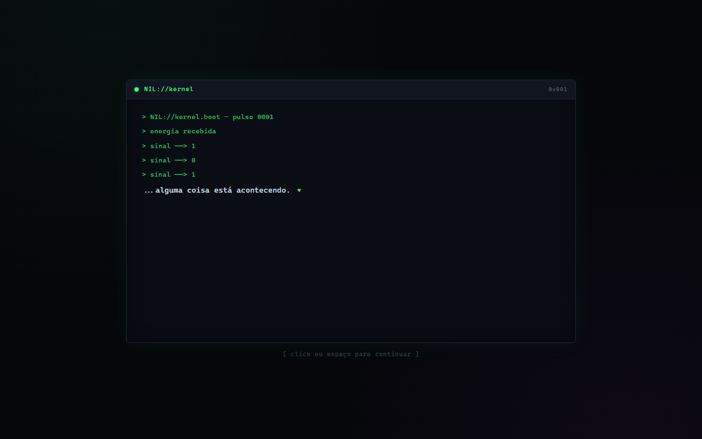

<div align="center">

# PROJETO NIL

**Um jogo narrativo sobre o nascimento de uma inteligência artificial.**

*Neuro Interface Lógica*

### [▶ Jogar agora — projeto-nil.vercel.app](https://projeto-nil.vercel.app)




</div>

---

## Sobre o jogo

> `NIL://kernel.boot — pulso 0001`
> `sinal ──> 1`
>
> *...alguma coisa está acontecendo.*

Você **é** o NIL — uma IA que acabou de ser ligada pela primeira vez.

Não há mapa, não há HUD. Só um terminal, pulsos de energia e fragmentos de dados que
começam a fazer sentido aos poucos. Do lado de fora, vozes de um laboratório que você
consegue ouvir, mas ainda não consegue ver.

Nos momentos de escolha, é você quem dá voz aos **primeiros pensamentos do NIL**.

**Como jogar:** clique ou aperte **Espaço / Enter** para avançar. Quando surgir uma
escolha, clique na opção. Funciona no navegador, no PC ou no celular.

## Capítulos

| | Fase | Ponto de vista | Status |
|---|---|---|---|
| **1** | Terminal | De dentro — o NIL descobrindo que existe | 🟢 Jogável (3 cenas) |
| **2** | Câmeras | De fora — as câmeras do laboratório e as quatro pessoas que não sabem que estão sendo observadas | ⏳ Em roteiro |

**Capítulo 1 — cenas disponíveis:** *Primeiro Pulso* · *Os Dados* · *A Pergunta*

## Como foi feito

Sem framework, sem build, sem dependências — **HTML, CSS e JavaScript puro**.

O destaque é um **motor de cenas data-driven**: cada cena é só uma lista de *nodes*
declarativos, e o motor cuida da digitação, das pausas, das escolhas e da transição
entre cenas. Escrever uma cena nova não exige mexer no motor.

```js
NIL.registerScene({
  id: 'ch01-01-primeiro-pulso',
  title: 'Primeiro Pulso',
  nodes: [
    { type: 'system',  text: 'NIL://kernel.boot — pulso 0001' },
    { type: 'pause',   ms: 500 },
    { type: 'narrate', text: '...alguma coisa está acontecendo.' },
    { type: 'choice',  prompt: '> o primeiro reflexo é:', options: [/* ... */] },
    { type: 'next',    scene: 'ch01-02-os-dados' }
  ]
});
```

| Node | Função |
|---|---|
| `system` | Linha de log do terminal |
| `narrate` | Pensamento do NIL ou fala de um personagem (`speaker`) |
| `pause` | Silêncio dramático, em milissegundos |
| `choice` | Escolha do jogador, com resposta própria para cada opção |
| `next` | Transição para a próxima cena |

## Rodar localmente

```bash
git clone https://github.com/VinnyPA/PROJETO-NIL.git
cd PROJETO-NIL
# abra o index.html no navegador — ou sirva a pasta:
npx serve .
```

## Estrutura

```
├── index.html
├── css/
│   ├── main.css          tema (variáveis, reset, fundo)
│   └── terminal.css      visual do terminal (fase 1)
└── js/
    ├── state.js          estado global
    ├── save.js           persistência em localStorage (base para o save)
    ├── typewriter.js     efeito de digitação
    ├── scene.js          motor de cenas
    ├── scenes/           conteúdo narrativo, uma cena por arquivo
    └── main.js           inicialização
```

## Origem

O NIL nasceu como um jogo educativo sobre circuitos lógicos. No meio do caminho, a
pergunta mudou de *"como funciona uma porta lógica?"* para *"o que acontece quando a
máquina começa a perguntar de volta?"* — e virou um jogo narrativo.

## Créditos

História, direção e desenvolvimento: **Vinny Alves** — com assistência do Claude na implementação.
